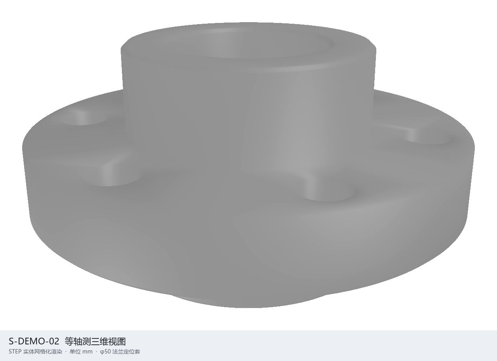

# STEP 比对

本地网页工具：一次打开一到两个 `.stp` / `.step` 文件，在浏览器里分屏或叠加查看三维外形。

文件只在本机处理，不上传到云端。



## 功能

- 槽位 **A**（必选）和 **B**（可选）
- 只开 A：单视口旋转、缩放
- A、B 都开：默认左右分屏，相机同步
- 可切到叠加：A 钢蓝、B 琥珀半透明
- 显示文件名、包围盒（毫米）、顶点数 / 面数
- 解析失败时给出可读错误，不把服务打挂

API 默认只监听 `127.0.0.1`。新页面使用 `POST /api/tessellate/v2`：响应只包含
模型元数据和短生命周期的 `glb_url`，再通过 `GET /api/models/{model_id}.glb`
获取二进制 GLB。原有 `POST /api/tessellate` 保留 Base64 JSON 形状，供旧调用方
迁移期间继续使用。

默认限制为单文件 100 MB、转换并发 1、内存缓存最多 4 个模型或 128 MB，缓存
30 分钟后过期，进程退出即清空。可用 `STEP_VIEWER_MAX_UPLOAD_BYTES`、
`STEP_VIEWER_CONVERSION_CONCURRENCY`、`STEP_VIEWER_MAX_CACHE_ENTRIES`、
`STEP_VIEWER_MAX_CACHE_BYTES` 和 `STEP_VIEWER_CACHE_TTL_SECONDS` 覆盖这些值。
STEP 长度单位必须能从声明中识别（mm、cm、m、in、ft 及常见 SI 前缀），结果统一
以毫米返回；未知单位不会猜测。

v2 错误使用稳定的 `code` / `message` JSON：`FILE_TOO_LARGE`（413）、
`INVALID_STEP`、`UNSUPPORTED_UNIT`、`EMPTY_MESH`、`INVALID_GLB`（422）、
`MODEL_NOT_FOUND`（404）和 `INTERNAL_ERROR`（500）。旧接口仍返回字符串
`detail`，以保持兼容。

第一期只做视觉比对，不做装配树、测量或几何级 diff。

## Windows 离线便携包

第一阶段交付 Windows 10/11 x64 便携包。目标机不需要安装 Python、Node.js
或任何依赖，也不需要网络。应用只监听本机回环地址，不会开放局域网访问。

### 构建包（在可联网的构建机）

构建机需要 Windows x64、Python 启动器 `py.exe`、pip 和 `curl.exe`。构建会从
Python.org 下载并校验 CPython 3.12.10 嵌入式运行时，从 PyPI 下载已锁定且带
SHA-256 的 Windows x64 wheels，然后生成 ZIP、ZIP 哈希与构建清单。

```powershell
powershell -ExecutionPolicy Bypass -File scripts\build-offline.ps1
```

输出在 `dist/`：

- `STEP-Compare-win-x64-1.0.0.zip`
- `STEP-Compare-win-x64-1.0.0.zip.sha256`

最终 ZIP 仅包含应用、嵌入式 Python、运行时依赖、本地 Three.js 和启动脚本；不包含
pip、wheel 缓存、构建下载器或临时文件。

### 在离线目标机运行

1. 校验 ZIP 的 SHA-256，与同名 `.sha256` 文件一致。
2. 完整解压 ZIP，不要只复制其中的 `start.bat`。
3. 双击 `start.bat`；需要其他端口时运行 `start.bat 9000`。
4. 启动器确认 `/api/health` 返回成功后打开默认浏览器。按 `Ctrl+C` 或关闭启动
   窗口会停止本地服务。

默认地址为 [http://127.0.0.1:8765](http://127.0.0.1:8765)。目标机需要有默认
浏览器，但不需要联网。

### 源码开发

运行时锁文件面向 Windows x64 / CPython 3.12。开发环境使用该解释器安装依赖：

```powershell
py -3.12 -m pip install -r requirements.txt
py -3.12 -m step_viewer --port 8765
```

命令默认打开浏览器；CI 或自动化可使用 `--no-browser`。当前便携包不支持 macOS、
Linux 或 32 位 Windows。

## 使用

1. 把第一个 STEP 拖进 **A**（或点击选择）。
2. 需要对比时，把第二个 STEP 拖进 **B**。
3. 用「分屏 / 叠加」切换对比方式，「适应窗口」重置视角。
4. 每个槽可以单独替换或清除。

示例零件 `S-DEMO-02.stp` 在仓库根目录。

## 结构

```text
step_viewer/          # FastAPI 服务：STEP → 毫米制 glTF
web/                  # 前端：Three.js 分屏 / 叠加
scripts/              # 离线构建器与便携启动器
tests/                # 网格化与接口测试
S-DEMO-02.stp         # 示例零件
```

本机服务默认监听 `127.0.0.1:8765`。浏览器上传文件后，由 `cascadio` 把 STEP 网格化，再在页面里显示。

## 测试与离线验收

```powershell
py -3.12 -m pip install --require-hashes -r requirements.txt
py -3.12 -m pip install -r requirements-dev.txt
py -3.12 -m pytest -q
node --test tests/test_view_align.mjs
npm ci
npx playwright install chromium
npm run test:e2e
```

Windows CI 会在 `windows-latest` 上重复上述检查，构建并解压便携 ZIP，验证包内
Python 导入、健康检查、首页和本地 Three.js。浏览器端到端验收还应覆盖上传/清除、
快速替换请求、GLTF 解析失败、重复加载后的资源释放、分屏/叠加和移动端单列布局；
验收时应确认开发者工具中没有外部网络请求或控制台错误。

构建后，从 `dist` 的 ZIP 解压到新目录，使用包内
`runtime\python\python.exe -m step_viewer --port 9010 --no-browser` 启动；确认
`/api/health`、首页、本地 Three.js 模块和示例 STEP 上传均正常。最终仍应在未安装
Python/Node 且断网的 Windows x64 虚拟机或实体机完成一次验收。
